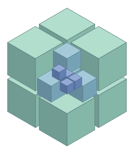
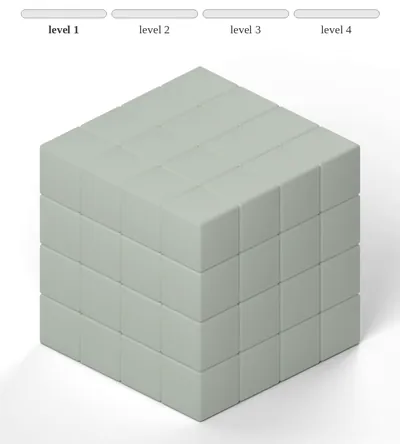
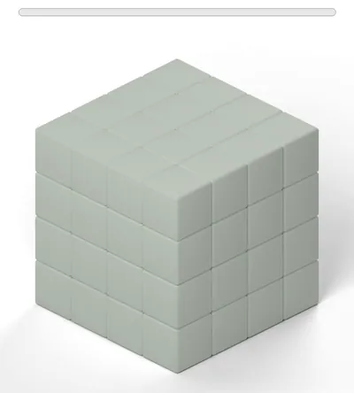

#  JoVox: Joint Hierarchical Flow Matching for Lightweight Voxel Generation

<a href="{{PAPER_URL}}"></a>
<a href="https://huggingface.co/{{HF_REPO}}"></a>
<a href="LICENSE"></a>

<table>
  <tr>
    <td align="center"><b>Level by level</b></td>
    <td align="center"><b>JoVox: all levels jointly</b></td>
  </tr>
  <tr>
    <td></td>
    <td></td>
  </tr>
</table>

**JoVox** is a discrete flow matching framework that learns the **joint hierarchical distribution** of voxels while keeping generation lightweight.
This repository releases the image-conditioned **64³** generator with its training, sampling and evaluation code.
An image-to-mesh script turns the generated structure into a mesh with the second stage of [TRELLIS.2](https://github.com/microsoft/TRELLIS.2).


## ✨ Features

### 1. Joint Hierarchical Generation
One model generates all levels, **4³ → 16³ → 64³**, from a single image.

### 2. Lightweight Training
Compared with TRELLIS.2 with the same backbone:
*   **8×** training throughput
*   **1/15** FLOPs per forward pass (0.82 vs. 12.2 TFLOPs)
*   **4 vs. 32** H100 GPUs to train

### 3. Accuracy
On 1000 Toys4k objects (image-conditioned), the Chamfer distance is **11% lower** than that of TRELLIS.2.

| Method | CD_V ↓ | IoU ↑ | CD_shell ↓ | FID_N ↓ | Uni3D ↑ |
| :--- | :--- | :--- | :--- | :--- | :--- |
| TRELLIS.2 | 0.01250 | 0.4017 | 0.524e-3 | 33.3 | 0.3865 |
| **JoVox** | **0.01107** | **0.4158** | **0.407e-3** | **31.6** | **0.3868** |

### 4. Image to Mesh
Three steps: background removal, structure generation, and meshing with the second stage of TRELLIS.2.


## 🛠 Installation

### Prerequisites
- **System**: Linux.
- **Hardware**: an NVIDIA GPU (tested on **A100**).
- **Software**: [CUDA Toolkit](https://developer.nvidia.com/cuda-toolkit-archive) 12.4, [Conda](https://docs.anaconda.com/miniconda/install/#quick-command-line-install), Python 3.10, PyTorch 2.6.0.

### Installation Steps
1. Clone the repo and create the environment:
    ```sh
    git clone https://github.com/yuyujunjun/JoVox.git
    cd JoVox
    conda create -n jovox python=3.10 -y && conda activate jovox
    pip install torch==2.6.0 torchvision==0.21.0 --index-url https://download.pytorch.org/whl/cu124
    pip install -r requirements.txt
    ```

2. Clone [TRELLIS.2](https://github.com/microsoft/TRELLIS.2) into `third_party/TRELLIS.2`, and install `flex_gemm`, `cumesh`,
   `nvdiffrast`, `utils3d` and `flash-attn` with its `setup.sh`:
    ```sh
    git clone --recursive https://github.com/microsoft/TRELLIS.2.git third_party/TRELLIS.2
    git -C third_party/TRELLIS.2 checkout 5565d24
    ```

3. Install [o-voxel-gpu](https://github.com/yuyujunjun/o-voxel-gpu) in place of the `o_voxel` that TRELLIS.2 ships:
    ```sh
    git clone --recursive https://github.com/yuyujunjun/o-voxel-gpu.git
    git -C o-voxel-gpu checkout fa9ae23
    pip install ./o-voxel-gpu --no-build-isolation
    ```

4. For evaluation only, install [PyTorch3D](https://github.com/facebookresearch/pytorch3d) (0.7.9 tested).

> The `prep` and `mesh` stages of [Image to Mesh](#1-image-to-mesh) run in a second environment set up by the
> TRELLIS.2 README, with o-voxel-gpu from step 3.


## 📦 Pretrained Weights

| Model | Resolution | Link |
| :--- | :--- | :--- |
| **JoVox** | 64³ | [Hugging Face](https://huggingface.co/{{HF_REPO}}) |

Download it together with the models that the code uses:
```sh
huggingface-cli download {{HF_REPO}} model.safetensors --local-dir checkpoints/voxelgen64
huggingface-cli download facebook/dinov3-vitl16-pretrain-lvd1689m        # gated: accept the license on its page first
huggingface-cli download microsoft/TRELLIS.2-4B --revision af44b45f2e35a493886929c6d786e563ec68364d
huggingface-cli download briaai/RMBG-2.0                                 # gated: accept the license on its page first
python -c "import lpips, torch; lpips.LPIPS(net='alex'); torch.hub.load('facebookresearch/dinov2', 'dinov2_vitl14_reg')"
```
*   **DINOv3**: encodes the condition image.
*   **TRELLIS.2-4B**, **RMBG-2.0**: second-stage meshing and background removal, used only by Image to Mesh.
*   **LPIPS**, **DINOv2**: used only by the evaluation.

All of them are read from the local caches (`$HF_HOME` and `$TORCH_HOME`), so a machine without internet access
can use copies downloaded elsewhere.


## 🚀 Usage

### 1. Image to Mesh
Run the three stages on a folder of images:
```sh
python scripts/img2mesh.py --stage prep  --in_dir <images> --out <out>   # TRELLIS.2 environment
python scripts/img2mesh.py --stage voxel --out <out> --seed 0             # this environment
python scripts/img2mesh.py --stage mesh  --out <out> --seed 0             # TRELLIS.2 environment
```
*   `prep` removes the background and centers the object. `--fill` sets how much of the image the object covers.
*   `voxel` generates the 64³ structure.
*   `mesh` turns the structure into a mesh with the second stage of TRELLIS.2.

The results are in `<out>/prep/` (centered images), `<out>/voxels/` (structures) and `<out>/mesh/` (one `.ply` per image).

### 2. Evaluation
Compare the structures generated by the released model with the ground truth of the same objects by CD_V, IoU and LPIPS_V.

1. Write the list of test objects to `data/splits/eval_cond.csv`, one row per object:

    | Column | Content |
    | :--- | :--- |
    | `split` | always `test` |
    | `subset`, `uid` | the object |
    | `image_path` | its condition image, under `data/renders/<subset>/renders3/<uid>/` |
    | `seed` | sampling seed |

2. Put the ground-truth meshes in one folder as `<uid>.glb`, and voxelize and render them:
    ```sh
    python scripts/voxelize_gt.py --dataset toys4k --src <mesh folder>
    python scripts/render_gt.py --dataset toys4k --method gt
    ```

3. Generate one structure per object:
    ```sh
    python scripts/generate.py --spec voxelgen64 --dataset toys4k
    ```

4. Compute the metrics:
    ```sh
    python scripts/evaluate.py --dataset toys4k --method voxelgen64 --compute_missing
    ```

The metrics are written to `data/gen/toys4k/voxelgen64/released/eval/toys4k/`:
*   `core.json`: `result.cd_p24_sum` is CD_V, `result.iou64` to `result.iou8` are the IoUs at 64³ to 8³
*   `core.csv`: the same metrics for every object
*   `vis_pair.json`: `vis_pair.lpips` is LPIPS_V

Add `--n N` to steps 3 and 4 to use only the first N objects.


## 🏋 Training

### 1. Data Preparation
Training reads, for each object, its occupancy and its condition images. We trained on the sketchfab, 3D-FUTURE,
HSSD and ABO subsets of TRELLIS-500K and kept Toys4k for testing.

| Path | Content |
| :--- | :--- |
| `$PROJECT_DATA/TRELLIS-500K-blender/<subset>/voxels/<uid>.vxz` | 64³ occupancy |
| `$PROJECT_DATA/TRELLIS-500K-blender/splits/{train,test}.csv` | objects of each split (columns `subset,uid`) |
| `$VFM_IMAGE_ROOT/<subset>/renders3/<uid>/*.png` | condition images (RGBA) |
| `$VFM_IMAGE_ROOT/<subset>/renders3/<uid>/transforms.json` | camera poses (optional) |

`PROJECT_DATA` defaults to `./data` and `VFM_IMAGE_ROOT` to `./data/TRELLIS-500K`.
If `transforms.json` is present, conditions are drawn from views with an elevation between −10° and 30° when there are any.

The occupancy is made from the meshes in two steps:
```sh
python scripts/voxelize_meshes.py --root <raw>/<subset> --max_workers 8
python scripts/to_blender_frame.py --src_root <raw>/<subset> --dst_root $PROJECT_DATA/TRELLIS-500K-blender/<subset>
```
*   `voxelize_meshes.py` voxelizes every mesh listed in `<raw>/<subset>/metadata.csv` (the file the
    TRELLIS.2 data toolkit writes) at 512³ and 64³.
*   `to_blender_frame.py` rotates the result from Y-up to Z-up, the orientation of the condition images.
*   Both accept `--rank` and `--world_size` to split the work over several jobs.

### 2. Running Training
```sh
accelerate launch --config_file configs/accelerate-train.yaml scripts/train.py --config configs/voxelgen64.yaml
```
The default configuration trains for 328,400 steps on 4 GPUs with 64 objects per GPU.
Any value can be changed on the command line, for example `train.batch_size=32`. The ones you are most likely to change:
*   `train.batch_size`: objects per GPU. Keep `batch_size × number of GPUs × train.accum_steps` at 256 to keep our schedule.
*   `model.num_levels`: number of levels. `2` generates 64³, and `3` adds one level and generates 256³ from the
    512³ occupancy (`<subset>/dual_grid_512/`). With `3`, also set `model.global_infer_root_end=[0.6,0.8]`
    (the fractions of sampling after which the two coarser levels are complete).
*   `logger.trackers`: `[tensorboard]` by default. Use `[tensorboard,wandb]` with `logger.wandb.entity=<entity>` to also log to Weights & Biases.

Checkpoints are saved to `exps/checkpoints/voxelgen/voxel_fm_64/<step>/`, and training resumes from the latest one.

### 3. Using Your Checkpoint
The commands above use the released model (`voxelgen64`). To use a checkpoint of your own training instead,
name it `voxelgen64_trained` and give its step:
```sh
python scripts/img2mesh.py --stage voxel --out <out> --spec voxelgen64_trained --step 328400          # Image to Mesh
python scripts/generate.py --spec voxelgen64_trained --step 328400 --dataset toys4k                   # Evaluation, step 3
python scripts/evaluate.py --dataset toys4k --method voxelgen64_trained --step 328400 --compute_missing # Evaluation, step 4
```


## 🧩 Related Packages

*   **[TRELLIS.2](https://github.com/microsoft/TRELLIS.2):**
    sparse transformer backbone, second-stage meshing, and data toolkit.
*   **[o-voxel-gpu](https://github.com/yuyujunjun/o-voxel-gpu):**
    GPU voxelization and voxel file I/O.


## ⚖ License

The code is released under the **[Apache-2.0 License](LICENSE)**.

The training code builds on [OpenLRM](https://github.com/3DTopia/OpenLRM) (Apache-2.0).
`voxelgen/network/backbone.py` and the image encoder in `voxelgen/network/model.py` build on
[TRELLIS.2](https://github.com/microsoft/TRELLIS.2) (MIT).
[DINOv3](https://huggingface.co/facebook/dinov3-vitl16-pretrain-lvd1689m) and [RMBG-2.0](https://huggingface.co/briaai/RMBG-2.0)
are under their own licenses (see their model pages).


## 📚 Citation

If you find this work useful, please cite:
```bibtex
{{BIBTEX}}
```
